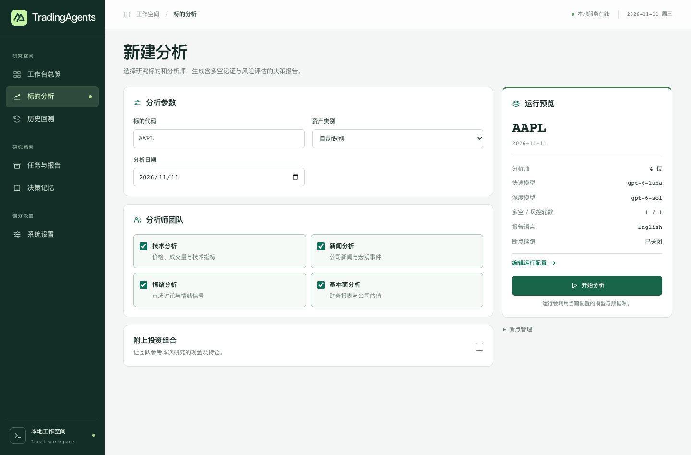

# TradingAgents Workbench

A local, Chinese-language browser interface for the TradingAgents multi-agent research framework. Choose an instrument and a historical date, watch analysts and risk reviewers work through the evidence, and inspect the resulting report.

[中文首页](README.md) · [Getting started (中文)](docs/QUICKSTART.md) · [Credits](ATTRIBUTION.md) · [Contributing](CONTRIBUTING.md)



## Run locally

Download this repository using **Code → Download ZIP**, extract it, and open a terminal in the directory containing `pyproject.toml`. On macOS or Linux with Python 3.11 or later:

```sh
python3 -m venv .venv
source .venv/bin/activate
python -m pip install .
tradingagents-web --open
```

On Windows, run `py -3.12 -m venv .venv` with an installed Python version, then run `.\.venv\Scripts\python.exe -m pip install .` and `.\.venv\Scripts\tradingagents-web.exe --open` in PowerShell.

The workstation opens at `http://127.0.0.1:8765`. Exploring the interface requires no key. To start research, open **系统设置** (Settings), configure your model provider, credentials, and quick/deep models. In **标的分析** (Analysis), enter a ticker such as `AAPL`, choose a completed trading day and select an analyst. Open **任务与报告** (Jobs & reports) to follow the run and read or download its report.

## What you can explore

- **Single-instrument analysis.** Compare technical, news, sentiment and fundamental perspectives alongside the bull/bear debate and risk review. Optionally include portfolio context.
- **Historical evaluation.** Sample instruments across dates, inspect ratings and available benchmark-relative outcomes, and resume a backtest by run ID.
- **Research history.** Inspect progress, stop an active job, revisit settled reflections, and export individual reports as Markdown or HTML.
- **Model configuration.** Choose providers, quick/deep models, report language and data sources in the browser. Settings apply to subsequent Web jobs.

The server binds to loopback and runs one job at a time. Closing the browser tab leaves that job running while the server stays up. Cloud providers receive research requests and may charge for them. Portfolio details can be part of model inputs. Local settings and saved credentials live in `~/.tradingagents/web/settings.json`. Market coverage and provider limits affect results. The workstation is for research and has no broker order entry.

## People and provenance

**@FlyingAngeryBird** maintains this independent community edition and its browser workflow, developed with assistance from Codex. Tauric Research and the upstream community built the research agents, execution graph, data adapters, backtesting, memory, CLI and reporting engine. The upstream paper is by Yijia Xiao, Edward Sun, Di Luo and Wei Wang. [Maintainer](https://github.com/FlyingAngeryBird) · [Upstream source at the fork point](https://github.com/TauricResearch/TradingAgents/tree/9fa1196fffbcfd9de5146d2dd2869df84ab99838) · [Paper](https://arxiv.org/abs/2412.20138)

Source code is distributed under Apache-2.0. Data, model services and upstream marks carry their respective terms. Contributions, reproducible bug reports and documentation improvements are welcome. [License](LICENSE) · [Attribution](ATTRIBUTION.md) · [Contributor guide](CONTRIBUTING.md)
