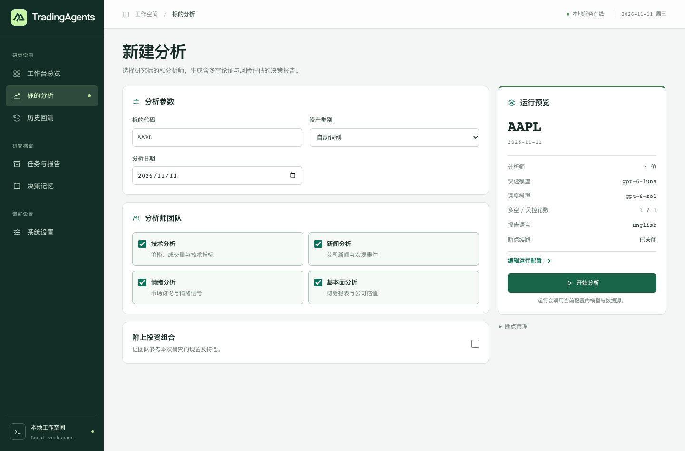

# TradingAgents Workbench · 多智能体投研工作台

<!-- Modified for the community Workbench edition. The original framework README is available at the upstream source link below. -->

在浏览器里看懂一次多智能体研究是怎样得出结论的。输入标的和日期，选择分析师，跟随多空辩论和风控评估，最后打开一份可以逐段复核的报告。

[English](README.en.md) · [首次使用](docs/QUICKSTART.md) · [项目来源与署名](ATTRIBUTION.md) · [参与贡献](CONTRIBUTING.md)



这是 @FlyingAngeryBird 维护的独立社区版本。Tauric Research 和开源贡献者开发了 TradingAgents 研究引擎；本仓库在此基础上增加中文 Web 界面、本机任务管理和浏览器配置。适合希望用同一组条件反复研究标的、比较模型判断，或学习多智能体工作流的人。[上游项目](https://github.com/TauricResearch/TradingAgents) · [改动与论文作者](ATTRIBUTION.md)

## 从一个标的开始

下载本仓库源码，进入包含 `pyproject.toml` 的目录。以下命令适用于 macOS 和 Linux，需要 Python 3.11 或以上版本。Windows 用户可按快速入门中的 PowerShell 步骤启动。[Windows 安装](docs/QUICKSTART.md)

```sh
python3 -m venv .venv
source .venv/bin/activate
python -m pip install .
tradingagents-web --open
```

浏览器会打开 `http://127.0.0.1:8765`。浏览界面无需密钥。想跑第一份研究，在「系统设置」选择自己可用的模型服务，保存快速模型、深度模型和所需凭证。然后进入「标的分析」，输入示例代码 `AAPL`，选择一个已收盘的交易日，只勾选「技术分析」，点击「开始分析」。

完成后，到「任务与报告」打开报告。先看技术分析引用的是哪一天的数据，再读多空双方的分歧，最后核对风控意见是否回应了这些分歧。报告中的评级是模型生成的研究判断。工作台没有券商下单接口。

## 可以用它做什么

| 你的问题 | 工作台里的操作 | 你可以检查的结果 |
| --- | --- | --- |
| 同一标的有哪些支持和反对理由？ | 选择技术、新闻、情绪或基本面分析师，可选填持仓 | 各分析师报告、多空论证、风险评估和最终评级 |
| 哪一步正在运行？ | 打开任务详情，查看进度，需要时停止 | 阶段、工具活动和已返回的内容 |
| 这套判断在历史日期上如何表现？ | 选择多个标的、日期范围与采样间隔，按编号续跑 | 各样本评级及可用的相对基准收益汇总 |
| 怎样复核之前的研究？ | 从报告库下载 Markdown 或 HTML，查看「决策记忆」 | 原始报告、历史评级和已结算的复盘 |
| 不同任务能用不同的模型吗？ | 在「系统设置」切换服务商、快速与深度模型、报告语言或数据源 | 运行预览显示当前配置，新任务按保存的配置执行 |

服务仅监听本机地址，同时运行一个任务。关闭标签页后任务可以继续，停止服务会中断当前任务。模型和行情服务需要相应的访问权限，云端调用可能计费。历史覆盖、供应商限流和缺失数据都会影响报告与回测。

## 数据和凭证

每位使用者配置自己的模型和数据源。网页保存的设置和凭证位于本机 `~/.tradingagents/web/settings.json`，环境变量示例见下方链接。研究时，选用的云端服务会收到相应请求，附加的投资组合可能进入模型上下文。分享报告、截图或问题日志前，请先移除个人信息。[配置样例](.env.example)

## 维护、贡献与许可

- **工作台维护者**　@FlyingAngeryBird 负责产品方向、发布与维护，开发过程中使用了 Codex 辅助。[维护者主页](https://github.com/FlyingAngeryBird)
- **研究框架与论文**　上游由 Tauric Research 与社区贡献者开发。原论文作者为 Yijia Xiao、Edward Sun、Di Luo、Wei Wang。本仓库的起点为上游提交 `9fa1196`。[论文](https://arxiv.org/abs/2412.20138) · [源码基线](https://github.com/TauricResearch/TradingAgents/tree/9fa1196fffbcfd9de5146d2dd2869df84ab99838)
- **参与开发**　欢迎复现数据问题、改进入门文档或提交界面改进。反馈时附上标的、日期、数据源和已经脱敏的复现步骤。如果工作台帮你完成了一次研究，欢迎在 GitHub 上给项目一颗 Star。[贡献指南](CONTRIBUTING.md)
- **许可**　工作台和上游框架源码按 Apache-2.0 分发。市场数据、模型服务和品牌标志分别受对应条款约束。[许可证](LICENSE) · [来源及使用条款](ATTRIBUTION.md)
